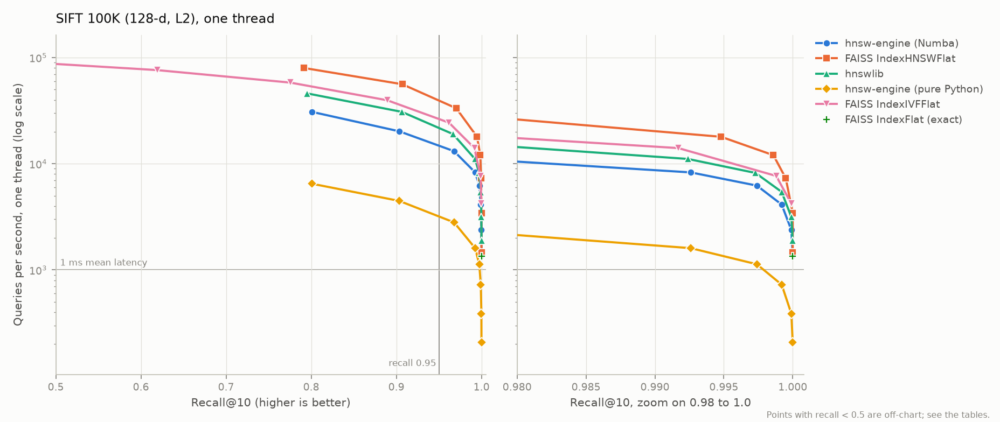
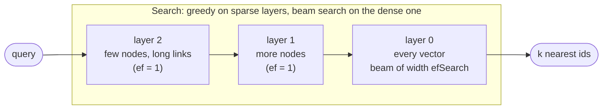

# hnsw-engine

**A vector search engine built from first principles.** Hierarchical Navigable Small World (HNSW)
graphs, the approximate nearest neighbour algorithm inside most vector databases, implemented
from the original paper (Malkov & Yashunin, 2016) twice: a readable pure-Python reference that
follows the paper line by line, and a compiled (Numba) engine proven to build the *bit-identical*
graph. Benchmarked against FAISS and hnswlib on SIFT, Fashion-MNIST and GloVe with one
single-threaded, process-isolated methodology: the same recall as FAISS at the same settings
(within 0.01 on the three 100K-scale datasets) with slightly fewer distance computations; the
compiled engine runs within 1.1-1.5x of hnswlib's throughput at recall 0.95 and 1.4-3.5x behind
FAISS, and every gap is measured and explained. On the full SIFT 1M it answers 4,447 queries/s at
recall 0.95 on one thread, 39x faster than exact search. Extensions: filtered search with
metadata predicates, int8 scalar quantization, and memory-mapped index files.

<picture>
  <source media="(prefers-color-scheme: dark)" srcset="docs/figures/sift100k_recall_qps_dark.png">
  
</picture>

## Headline results

SIFT-128, first 100,000 vectors, 1,000 queries, recall@10, one thread, M = 16,
efConstruction = 200 for every HNSW implementation (Apple M5). Fashion-MNIST and GloVe results,
methodology and analysis: [`docs/BENCHMARKS.md`](docs/BENCHMARKS.md).

<!-- table:sift100k_summary -->
| Index | Build (s) | Index RSS (MB) | Index size (MB) | Max recall@10 | QPS @ recall>=0.90 | QPS @ recall>=0.95 | QPS @ recall>=0.99 |
|---|---:|---:|---:|---:|---:|---:|---:|
| hnsw-engine-numba | 20.07 | 110.3 | 65.3 | 1.0000 | 20,223 | 13,142 | 8,293 |
| faiss-hnsw | 9.58 | 65.2 | 65.6 | 1.0000 | 56,150 | 33,338 | 17,958 |
| hnswlib | 15.42 | 83.7 | 66.1 | 1.0000 | 30,833 | 19,043 | 11,101 |
| hnsw-engine-reference | 206.36 | 99.0 | 65.3 | 1.0000 | 4,469 | 2,805 | 1,604 |
| faiss-ivf | 0.88 | 105.4 | 52.5 | 0.9999 | 24,400 | 24,400 | 14,050 |
| faiss-flat | 0.01 | 51.3 | 51.2 | 1.0000 | 1,352 | 1,352 | 1,352 |
<!-- /table:sift100k_summary -->

`hnsw-engine-numba` is the compiled engine (default), `hnsw-engine-reference` the pure-Python one.
Both build the same graph; compiling it made queries 4.5-6.6x and builds 10.3x faster
([`docs/PERFORMANCE.md`](docs/PERFORMANCE.md)).

**At 1M vectors** (full SIFT, same settings): 4,447 queries/s at recall >= 0.95, against 6,193
for hnswlib and 10,301 for FAISS; ten times more data cost the graph 2.96x in throughput and exact
search 11.90x ([`docs/BENCHMARKS.md`](docs/BENCHMARKS.md)).

## Beyond the paper (Tier 3)

* **Filtered search.** `search(..., filter=mask)` returns only vectors whose mask entry is true,
  with hnswlib's semantics (the search passes through excluded nodes but never returns them), in
  both engines, proven identical by tests. The study in [`docs/STUDIES.md`](docs/STUDIES.md)
  shows why production systems need a planner: the in-graph filter keeps recall@10 at 0.95 or
  more for every predicate but its cost grows as the predicate gets selective; exact search over
  the allowed vectors wins below about 5% for random predicates and already at 10% for predicates
  correlated with position; post-filtering and FAISS's filter lose recall on selective predicates.
* **int8 scalar quantization.** `QuantizedIndex` traverses the graph with one-byte codes, reusing
  the same compiled search, and can re-rank the beam with exact distances. Lossless on SIFT and
  Fashion-MNIST (8-bit data) with a quarter of the vector memory; on GloVe the codes cost up to
  0.0214 recall, which re-ranking recovers.
* **Memory-mapped index files.** `save_native` / `load_native` store the compiled engine's arrays
  as `.npy` files that open in place: the 1M SIFT index opens in 0.058 s with every link validated
  (0.001 s for trusted files) against 1.665 s for the `.npz` archive. With a cold page cache,
  mapping moves the cost into the first queries (1.761 s for the first 1,000, against 0.186 s
  after loading into memory) ([`docs/PERFORMANCE.md`](docs/PERFORMANCE.md), section 5).

## How it works



* **Layers.** Each vector gets a random top layer, `floor(-ln(U) / ln(M))`, so every layer holds
  about `1/M` of the one below: a skip list over a proximity graph.
* **Search.** Start at the entry point on the top layer, move greedily to whichever neighbour is
  closer to the query, drop a layer, repeat; on layer 0 run a best-first beam search that keeps
  the `efSearch` closest nodes seen. A wider beam buys recall with time.
* **Insertion.** Search for the new vector's neighbours with a beam of `efConstruction`, then link
  to `M` of them chosen by the paper's **heuristic**: keep a candidate only if it is closer to the
  new node than to any neighbour already kept. On clustered data this is the difference between a
  connected graph and stranded nodes ([`docs/STUDIES.md`](docs/STUDIES.md)).

## What makes it trustworthy

* **Exact oracle** (`oracle.py`): brute force that is provably exact even where float32 is not
  (float32 filtering with a derived error margin, then float64 re-ranking; ties to the lower id).
  Cross-checked against the published ground truth of all three datasets: every published SIFT
  and Fashion-MNIST top-10 list is a correct answer under the oracle (differences are exact ties),
  and 999 of 1,000 GloVe lists (one near-tie of 2e-9) ([`docs/DATASETS.md`](docs/DATASETS.md)).
* **Two engines, one graph.** Equivalence tests (including property-based ones) require identical
  graphs and results from the readable and the compiled engine, filtered searches included.
* **Safe loading.** Index files contain no pickle, and every load validates each link before the
  compiled code (which does not bounds-check) can follow it; damaged files are rejected with a
  message, not a crash.
* **336 tests in total**: structural invariants after every build, an exactness regime (no pruning,
  `ef = n`) that must equal the oracle, `hypothesis` property tests, filtered search against brute
  force, quantization, persistence round-trips, corrupted-file rejection and the benchmark
  harness; ruff and strict mypy clean; CI on every push.
* **Fair, hardened benchmarks**: every index in its own process, one thread for every library,
  warm-up, three timed repetitions, cool-downs, tie-aware recall, raw JSON with the full
  environment, power source and thermal state; runs during which the machine slept are detected
  and repeated (it happened once, and that run was discarded).

## Quick start

```bash
uv venv --python 3.12 .venv && uv pip install -e "hnsw-engine[bench,dev]"
```

```python
import numpy as np
from hnsw_engine import HNSWIndex

data = np.random.default_rng(0).normal(size=(10_000, 64)).astype("float32")
index = HNSWIndex(dim=64, metric="l2", M=16, ef_construction=200, seed=0)  # compiled engine
index.add(data)
ids, distances = index.search(data[0], k=10)       # ids[0] == 0
index.save("index.npz")                            # pickle-free, versioned format

in_stock = np.random.default_rng(1).random(len(index)) < 0.2       # any boolean mask
ids, distances = index.search(data[0], k=10, filter=in_stock)      # only allowed vectors

from hnsw_engine import QuantizedIndex
small = QuantizedIndex(index)                      # one byte per dimension
ids, distances = small.batch_search(data[:5], k=10, ef=80, rerank=80)

index.save_native("index_dir")                     # one .npy file per engine array
index = HNSWIndex.load_native("index_dir")         # memory-mapped, opens in place
```

`make check` runs lint, type checks and tests; `make bench-quick` a few-minute benchmark;
`make reproduce` regenerates every published number (about 1.5 hours).

## Limitations

* The compiled engine is still 1.1-3.5x slower than the C++ libraries at recall 0.95: it keeps
  float64 arithmetic to stay bit-identical with the reference, pays about 7 µs of Python per query,
  and allocates heaps per search ([`docs/PERFORMANCE.md`](docs/PERFORMANCE.md)).
* Single-threaded; no deletions or updates. Memory-mapped files remove the need to load an index
  into RAM, but searches still touch a large share of it.
* The three-library comparison uses 100K-vector subsets of SIFT and GloVe and the full 60K
  Fashion-MNIST; the full SIFT 1M was run without the pure-Python engine.
* Laptop timings: comparisons within one run are reliable; absolute numbers vary between runs.

## What production systems do at billion scale

A single in-memory HNSW graph stops being enough well before a billion vectors:

* **Sharding**: split the collection across machines, search every shard in parallel and merge the
  top-k lists. This trades network fan-out for memory per machine.
* **Compression with product quantization (PQ)**: store 8-32 byte codes instead of 512-byte float
  vectors, compute approximate distances from lookup tables, and re-rank a short list with full
  vectors (FAISS `IndexIVFPQ`, `IndexHNSWPQ`).
* **Disk-based indexes**: DiskANN/Vamana keeps a compressed copy in RAM and the graph plus full
  vectors on SSD, serving billion-point datasets from one machine with a few SSD reads per query.
* **Filtered search with a planner**: real queries add metadata constraints ("in stock",
  "language = en"). Engines estimate how selective a predicate is and choose between filter-aware
  graph traversal and brute force over the matching subset; this repository's filtered-search
  study measures where that switch pays off.

## Documents

[`DESIGN.md`](docs/DESIGN.md) (architecture and exact semantics) ·
[`DECISIONS.md`](docs/DECISIONS.md) · [`DATASETS.md`](docs/DATASETS.md) ·
[`BENCHMARKS.md`](docs/BENCHMARKS.md) · [`PERFORMANCE.md`](docs/PERFORMANCE.md) ·
[`STUDIES.md`](docs/STUDIES.md) · [`REPORT.md`](docs/REPORT.md)
