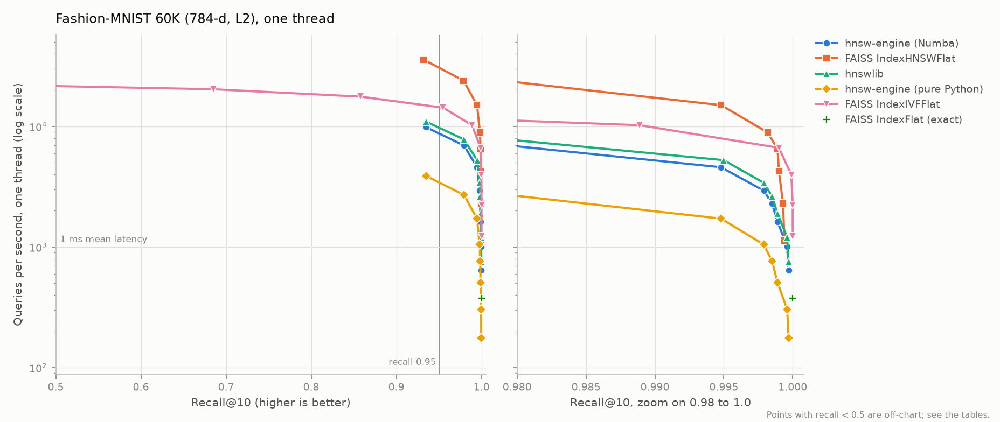
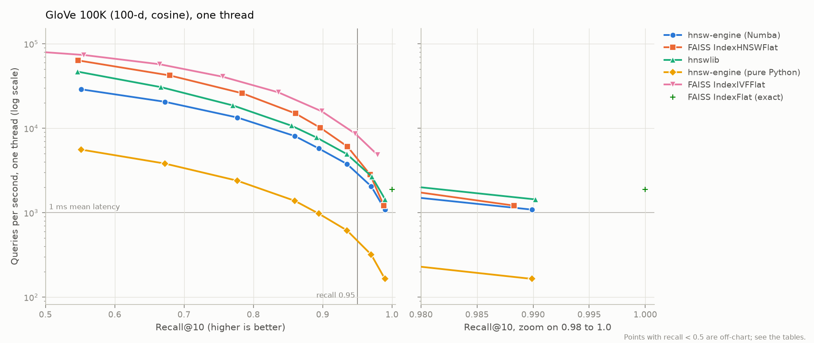
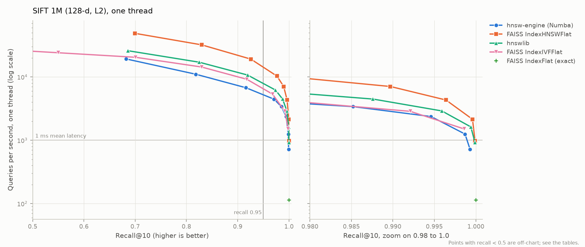

# Benchmarks

How this HNSW implementation compares with FAISS and hnswlib on three standard ANN-Benchmarks
datasets, measured with one methodology for every library. Tables between `<!-- table:... -->`
markers are generated by `benchmarks/report_ann.py` from the raw result files and pasted in
automatically; every number traces to `results/ann/<run>/<index>.json`. Full per-point tables
(every efSearch or nprobe value with mean, p50 and p99 latency) are in `docs/tables/*_points.md`.

## Headline

Single thread, M = 16, efConstruction = 200 for every HNSW implementation, 1,000 queries per
dataset. Derived ratios: `results/ann/derived_stats.json` (`benchmarks/derive_stats.py`).

* **Same algorithm, same accuracy.** At identical parameters our recall@10 stays within 0.0096 of
  FAISS on SIFT, 0.0033 on Fashion-MNIST and 0.0072 on GloVe (within 0.0064 of hnswlib everywhere),
  while computing 0.8-9.0% fewer distances per query than FAISS. The compiled and pure-Python
  engines produce identical recall and identical distance counts at every setting on all three
  datasets: they build the same graph.
* **The compiled engine is within 1.1-1.5x of hnswlib.** At recall >= 0.95 it serves 13,142
  queries/s on SIFT (hnswlib 19,043, FAISS 33,338), 6,948 on Fashion-MNIST (hnswlib 7,810, FAISS
  23,982) and 2,055 on GloVe (hnswlib 2,676, FAISS 2,833). It builds 100K SIFT vectors in 20.1 s
  (hnswlib 15.4 s, FAISS 9.6 s).
* **Compiling the same algorithm made it 4.5x to 6.6x faster to query and 10.3x faster to build** on
  SIFT, relative to the readable pure-Python engine (2,805 queries/s at recall >= 0.95, 206.4 s build).
* **GloVe is hard for graphs.** Recall 0.95 needs efSearch 400 for every HNSW library; at that
  recall our engine is only 1.09x faster than FAISS's exact brute force, and FAISS IVF is fastest
  (4,823 queries/s).
* **At the full SIFT 1M (Tier 3) the graph pays off.** At recall >= 0.95 the compiled engine serves
  4,447 queries/s, 39.2x the throughput of exact search (9.7x at 100K), and stays within
  1.23-1.59x of hnswlib across recall targets 0.90-0.99.

## SIFT, first 100,000 vectors (128-d, L2)


<!-- table:sift100k_summary -->
| Index | Build (s) | Index RSS (MB) | Index size (MB) | Max recall@10 | QPS @ recall>=0.90 | QPS @ recall>=0.95 | QPS @ recall>=0.99 |
|---|---:|---:|---:|---:|---:|---:|---:|
| hnsw-engine-numba | 20.07 | 110.3 | 65.3 | 1.0000 | 20,223 | 13,142 | 8,293 |
| faiss-hnsw | 9.58 | 65.2 | 65.6 | 1.0000 | 56,150 | 33,338 | 17,958 |
| hnswlib | 15.42 | 83.7 | 66.1 | 1.0000 | 30,833 | 19,043 | 11,101 |
| hnsw-engine-reference | 206.36 | 99.0 | 65.3 | 1.0000 | 4,469 | 2,805 | 1,604 |
| faiss-ivf | 0.88 | 105.4 | 52.5 | 0.9999 | 24,400 | 24,400 | 14,050 |
| faiss-flat | 0.01 | 51.3 | 51.2 | 1.0000 | 1,352 | 1,352 | 1,352 |
<!-- /table:sift100k_summary -->

**Equal parameters** (M = 16, efConstruction = 200, same efSearch; distance computations from each
library's own counters, hnswlib exposes none):

<!-- table:sift100k_equal_ef -->
| efSearch | Recall: ours (Numba) | Recall: ours (Python) | Recall: FAISS | Recall: hnswlib | Distances/query: ours (Numba) | Distances/query: ours (Python) | Distances/query: FAISS | QPS: ours (Numba) | QPS: ours (Python) | QPS: FAISS | QPS: hnswlib |
|---:|---:|---:|---:|---:|---:|---:|---:|---:|---:|---:|---:|
| 10 | 0.8010 | 0.8010 | 0.7914 | 0.7952 | 300.5 | 300.5 | 314.5 | 30,800 | 6,482 | 79,872 | 46,013 |
| 20 | 0.9034 | 0.9034 | 0.9069 | 0.9064 | 444.1 | 444.1 | 460.5 | 20,223 | 4,469 | 56,150 | 30,833 |
| 40 | 0.9678 | 0.9678 | 0.9704 | 0.9665 | 712.2 | 712.2 | 729.9 | 13,142 | 2,805 | 33,338 | 19,043 |
| 80 | 0.9926 | 0.9926 | 0.9948 | 0.9924 | 1,189.8 | 1,189.8 | 1,213.3 | 8,293 | 1,604 | 17,958 | 11,101 |
| 120 | 0.9974 | 0.9974 | 0.9986 | 0.9973 | 1,613.8 | 1,613.8 | 1,643.4 | 6,228 | 1,131 | 12,043 | 8,195 |
| 200 | 0.9992 | 0.9992 | 0.9995 | 0.9992 | 2,365.3 | 2,365.3 | 2,401.2 | 4,128 | 727 | 7,276 | 5,430 |
| 400 | 0.9999 | 0.9999 | 1.0000 | 0.9999 | 3,918.9 | 3,918.9 | 3,961.5 | 2,376 | 387 | 3,443 | 3,155 |
| 800 | 1.0000 | 1.0000 | 1.0000 | 1.0000 | 6,360.8 | 6,360.8 | 6,411.9 | 1,377 | 208 | 1,468 | 1,881 |
<!-- /table:sift100k_equal_ef -->

## Fashion-MNIST, all 60,000 vectors (784-d, L2)



<!-- table:fmnist60k_summary -->
| Index | Build (s) | Index RSS (MB) | Index size (MB) | Max recall@10 | QPS @ recall>=0.90 | QPS @ recall>=0.95 | QPS @ recall>=0.99 |
|---|---:|---:|---:|---:|---:|---:|---:|
| hnsw-engine-numba | 41.43 | 418.2 | 196.6 | 0.9997 | 9,838 | 6,948 | 4,586 |
| faiss-hnsw | 12.13 | 158.8 | 196.8 | 0.9994 | 35,895 | 23,982 | 15,009 |
| hnswlib | 34.72 | 209.8 | 197.1 | 0.9997 | 10,942 | 7,810 | 5,249 |
| hnsw-engine-reference | 192.13 | 406.8 | 196.6 | 0.9997 | 3,881 | 2,702 | 1,719 |
| faiss-ivf | 1.13 | 294.7 | 191.9 | 1.0000 | 14,299 | 14,299 | 6,646 |
| faiss-flat | 0.02 | 188.3 | 188.2 | 1.0000 | 378 | 378 | 378 |
<!-- /table:fmnist60k_summary -->

<!-- table:fmnist60k_equal_ef -->
| efSearch | Recall: ours (Numba) | Recall: ours (Python) | Recall: FAISS | Recall: hnswlib | Distances/query: ours (Numba) | Distances/query: ours (Python) | Distances/query: FAISS | QPS: ours (Numba) | QPS: ours (Python) | QPS: FAISS | QPS: hnswlib |
|---:|---:|---:|---:|---:|---:|---:|---:|---:|---:|---:|---:|
| 10 | 0.9351 | 0.9351 | 0.9318 | 0.9351 | 209.2 | 209.2 | 229.9 | 9,838 | 3,881 | 35,895 | 10,942 |
| 20 | 0.9794 | 0.9794 | 0.9789 | 0.9792 | 299.1 | 299.1 | 320.6 | 6,948 | 2,702 | 23,982 | 7,810 |
| 40 | 0.9948 | 0.9948 | 0.9948 | 0.9950 | 451.0 | 451.0 | 473.7 | 4,586 | 1,719 | 15,009 | 5,249 |
| 80 | 0.9979 | 0.9979 | 0.9982 | 0.9979 | 699.4 | 699.4 | 723.7 | 2,934 | 1,049 | 8,886 | 3,406 |
| 120 | 0.9985 | 0.9985 | 0.9989 | 0.9985 | 906.7 | 906.7 | 931.1 | 2,287 | 763 | 6,459 | 2,637 |
| 200 | 0.9989 | 0.9989 | 0.9990 | 0.9989 | 1,257.5 | 1,257.5 | 1,281.7 | 1,619 | 507 | 4,249 | 1,891 |
| 400 | 0.9996 | 0.9996 | 0.9993 | 0.9996 | 1,956.8 | 1,956.8 | 1,981.6 | 1,008 | 304 | 2,290 | 1,203 |
| 800 | 0.9997 | 0.9997 | 0.9994 | 0.9997 | 3,048.7 | 3,048.7 | 3,072.7 | 640 | 176 | 1,132 | 760 |
<!-- /table:fmnist60k_equal_ef -->

## GloVe, first 100,000 vectors (100-d, cosine)



<!-- table:glove100k_summary -->
| Index | Build (s) | Index RSS (MB) | Index size (MB) | Max recall@10 | QPS @ recall>=0.90 | QPS @ recall>=0.95 | QPS @ recall>=0.99 |
|---|---:|---:|---:|---:|---:|---:|---:|
| hnsw-engine-numba | 25.99 | 176.9 | 54.1 | 0.9899 | 3,774 | 2,055 | - |
| faiss-hnsw | 13.06 | 93.9 | 54.4 | 0.9883 | 6,078 | 2,833 | - |
| hnswlib | 19.94 | 73.1 | 54.9 | 0.9902 | 4,942 | 2,676 | 1,437 |
| hnsw-engine-reference | 232.41 | 171.2 | 54.1 | 0.9899 | 617 | 319 | - |
| faiss-ivf | 0.73 | 126.5 | 41.2 | 0.9794 | 8,631 | 4,823 | - |
| faiss-flat | 0.01 | 80.1 | 40.0 | 1.0000 | 1,889 | 1,889 | 1,889 |
<!-- /table:glove100k_summary -->

<!-- table:glove100k_equal_ef -->
| efSearch | Recall: ours (Numba) | Recall: ours (Python) | Recall: FAISS | Recall: hnswlib | Distances/query: ours (Numba) | Distances/query: ours (Python) | Distances/query: FAISS | QPS: ours (Numba) | QPS: ours (Python) | QPS: FAISS | QPS: hnswlib |
|---:|---:|---:|---:|---:|---:|---:|---:|---:|---:|---:|---:|
| 10 | 0.5515 | 0.5515 | 0.5468 | 0.5463 | 424.8 | 424.8 | 447.7 | 28,958 | 5,595 | 63,759 | 46,916 |
| 20 | 0.6722 | 0.6722 | 0.6794 | 0.6669 | 639.5 | 639.5 | 679.8 | 20,616 | 3,824 | 42,277 | 30,704 |
| 40 | 0.7769 | 0.7769 | 0.7840 | 0.7705 | 1,029.1 | 1,029.1 | 1,080.4 | 13,420 | 2,395 | 25,997 | 18,653 |
| 80 | 0.8599 | 0.8599 | 0.8607 | 0.8551 | 1,740.5 | 1,740.5 | 1,830.6 | 8,092 | 1,383 | 14,999 | 10,730 |
| 120 | 0.8943 | 0.8943 | 0.8966 | 0.8911 | 2,423.5 | 2,423.5 | 2,544.0 | 5,778 | 977 | 10,157 | 7,782 |
| 200 | 0.9352 | 0.9352 | 0.9358 | 0.9350 | 3,724.4 | 3,724.4 | 3,895.8 | 3,774 | 617 | 6,078 | 4,942 |
| 400 | 0.9701 | 0.9701 | 0.9685 | 0.9710 | 6,723.3 | 6,723.3 | 6,993.8 | 2,055 | 319 | 2,833 | 2,676 |
| 800 | 0.9899 | 0.9899 | 0.9883 | 0.9902 | 12,044.6 | 12,044.6 | 12,424.8 | 1,088 | 164 | 1,214 | 1,437 |
<!-- /table:glove100k_equal_ef -->

## SIFT, all 1,000,000 vectors (128-d, L2)

Tier 3 scale check: the full ANN-Benchmarks SIFT dataset, the same 1,000 queries, the same
parameters and harness. The pure-Python engine is left out: its build would take far longer than
the 20-minute time box allows, and it builds the same graph as the compiled engine (`DECISIONS.md`,
D18).



<!-- table:sift1m_summary -->
| Index | Build (s) | Index RSS (MB) | Index size (MB) | Max recall@10 | QPS @ recall>=0.90 | QPS @ recall>=0.95 | QPS @ recall>=0.99 |
|---|---:|---:|---:|---:|---:|---:|---:|
| hnsw-engine-numba | 378.22 | 121.5 | 652.6 | 0.9993 | 6,742 | 4,447 | 2,367 |
| faiss-hnsw | 191.84 | 569.7 | 656.3 | 0.9999 | 19,097 | 10,301 | 4,317 |
| hnswlib | 303.73 | 431.6 | 660.5 | 0.9999 | 10,696 | 6,193 | 2,903 |
| faiss-ivf | 32.50 | 852.4 | 522.1 | 0.9986 | 9,168 | 5,345 | 2,860 |
| faiss-flat | 0.04 | 512.1 | 512.0 | 1.0000 | 114 | 114 | 114 |
<!-- /table:sift1m_summary -->

<!-- table:sift1m_equal_ef -->
| efSearch | Recall: ours (Numba) | Recall: FAISS | Recall: hnswlib | Distances/query: ours (Numba) | Distances/query: FAISS | QPS: ours (Numba) | QPS: FAISS | QPS: hnswlib |
|---:|---:|---:|---:|---:|---:|---:|---:|---:|
| 10 | 0.6825 | 0.6996 | 0.6861 | 373.7 | 399.2 | 19,197 | 48,724 | 25,897 |
| 20 | 0.8181 | 0.8296 | 0.8249 | 550.3 | 582.2 | 11,029 | 32,080 | 17,070 |
| 40 | 0.9162 | 0.9256 | 0.9193 | 871.5 | 923.5 | 6,742 | 19,097 | 10,696 |
| 80 | 0.9709 | 0.9766 | 0.9738 | 1,477.4 | 1,564.5 | 4,447 | 10,301 | 6,193 |
| 120 | 0.9852 | 0.9897 | 0.9876 | 2,043.2 | 2,162.2 | 3,394 | 7,056 | 4,470 |
| 200 | 0.9946 | 0.9964 | 0.9959 | 3,100.0 | 3,269.3 | 2,367 | 4,317 | 2,903 |
| 400 | 0.9987 | 0.9996 | 0.9994 | 5,437.4 | 5,714.1 | 1,251 | 2,142 | 1,623 |
| 800 | 0.9993 | 0.9999 | 0.9999 | 9,444.1 | 9,884.2 | 722 | 982 | 920 |
<!-- /table:sift1m_equal_ef -->

*What changes at 1M* (ratios from `results/ann/derived_stats.json`):

* **Graph search scales; brute force does not.** Ten times more vectors cut our throughput at
  recall >= 0.95 by 2.96x (FAISS HNSW 3.24x, hnswlib 3.08x) but exact search by 11.90x, so our
  engine's lead over exact search grew from 9.7x to 39.2x. Builds took 18.8-20.0x longer for the
  three HNSW implementations.
* **Accuracy at equal settings.** Our recall is 0.0006-0.0171 below FAISS and 0.0006-0.0068 below
  hnswlib at equal efSearch, while computing 4.5-6.4% fewer distances than FAISS. The gap is
  largest at the smallest beam (0.6825 against 0.6996 at efSearch 10) and closes as the beam
  grows; our best recall is 0.9993 at efSearch 800 (FAISS and hnswlib 0.9999).
* **Speed.** At recall >= 0.95 we serve 4,447 queries/s against 6,193 for hnswlib (1.39x) and
  10,301 for FAISS (2.32x); across the recall targets 0.90-0.99 the gap to hnswlib is 1.23-1.59x.
  FAISS IVF (nlist 4,096) reaches recall 0.95 at 5,345 queries/s (nprobe 64) after a 32.5 s build.
* **Memory.** Index sizes are 652.6 MB (ours), 656.3 MB (FAISS) and 660.5 MB (hnswlib). Process
  memory deltas are not usable at this scale: ours (121.5 MB) is smaller than the index's own
  arrays, which cannot happen if every page stays resident. The likely cause is macOS compressing
  idle pages (the input array) during the 378 s build (`DECISIONS.md`, D13 and D18).
* **Conditions.** All five runs completed on the first attempt with no sleep detected (largest
  `suspended_seconds` 1.1e-05), on battery power, Low Power Mode off, no thermal warnings.

## Environment

<!-- table:sift100k_environment -->
| | |
|---|---|
| CPU | Apple M5 (4 performance + 6 efficiency cores) |
| RAM | 16 GiB |
| OS | macOS 26.6 (macOS-26.6-arm64-arm-64bit) |
| Python | 3.12.15 |
| Libraries | numpy 2.5.3, numba 0.68.0, llvmlite 0.50.0, faiss-cpu 1.15.1, hnswlib 0.8.0, h5py 3.16.0, psutil 7.2.2, threadpoolctl 3.7.0, hnsw-engine 0.1.0 |
| Threads | 1 for every library (OMP_NUM_THREADS=1, OPENBLAS_NUM_THREADS=1, MKL_NUM_THREADS=1, VECLIB_MAXIMUM_THREADS=1, NUMEXPR_NUM_THREADS=1, NUMBA_NUM_THREADS=1) |
| Run date (UTC) | 2026-10-03T04:13:17+00:00 |
<!-- /table:sift100k_environment -->

## Analysis

**Where the algorithm matches.** The equal-parameter tables are the evidence that the
implementation is faithful. Recall agrees with FAISS and hnswlib to within 0.01 at every efSearch
on the three 100K-scale datasets (at SIFT 1M the gap to FAISS reaches 0.0171 at efSearch 10 and
shrinks as the beam grows), and we compute slightly fewer distances than FAISS (0.8-4.4% on SIFT,
0.8-9.0% on Fashion-MNIST, 3.1-5.9% on GloVe). The gaps at small efSearch are larger than the
spread between our own builds with different seeds (at most 0.0050 on SIFT 100K; see Threats to
validity), so they are not only chance: the libraries differ in details of neighbour selection and
search (hnswlib, for example, skips the heuristic when a node has at most M candidates;
`DESIGN.md` section 5). They vanish as efSearch grows. The two engines of this project agree
exactly: same recall, same distance counts, at every point.

**Where and why the compiled engine still loses to FAISS.** The ratio FAISS/ours shrinks as
efSearch grows: on SIFT from 2.59x at efSearch 10 to 1.07x at efSearch 800, on GloVe from 2.20x to
1.12x, on Fashion-MNIST from 3.65x to 1.77x. Work per query grows with efSearch while our extra
costs are largely fixed per query: about 7 µs of Python (validation, preparation, dispatch into
compiled code; `PERFORMANCE.md`) plus per-search setup inside the kernel (allocating heap lists).
The rest is arithmetic: we accumulate distances in float64 to stay bit-identical with the
reference, whereas FAISS uses SIMD float32 kernels; this matters most on Fashion-MNIST, whose
784-dimensional vectors make each distance six times longer than on SIFT, which is why the gap
there stays widest at high efSearch. Against hnswlib, whose distance code is closer to ours, the
gap is 1.1-1.2x on Fashion-MNIST and 1.3-1.6x on SIFT and GloVe.

**What compiling bought.** Same graph, same work, 4.5-6.6x more queries per second on SIFT (2.5-3.6x
on Fashion-MNIST, likely because long 784-dimensional distances make the pure-Python engine's NumPy
calls comparatively efficient, and 5.2-6.6x on GloVe), and builds 10.3x faster on SIFT (4.6x on Fashion-MNIST, 8.9x on GloVe).
The profile in `PERFORMANCE.md` explains why: the pure-Python engine's time went to millions of
tiny function calls, which compilation removes entirely.

**ANN versus brute force.** On SIFT our compiled engine at recall >= 0.95 is 9.7x faster than
FAISS's exact search, on Fashion-MNIST 18.4x, but on GloVe only 1.09x. GloVe's word vectors have
high intrinsic dimensionality, so every graph needs a wide beam: recall first exceeds 0.95 at
efSearch 400.
FAISS IVF, which scans whole clusters, does better there (4,823 queries/s at recall >= 0.95) but
cannot exceed recall 0.98 with 1,024 lists.

**Memory.** The compact graph-plus-vector size is the same for every HNSW implementation (65.3 MB
ours, 65.6 MB FAISS, 66.1 MB hnswlib on SIFT), as expected from identical M. Resident-memory growth
is noisier: it includes interpreter and allocator effects (macOS compresses and reuses memory, and
freed buffers stay in the process), so the pure-Python and compiled builds grew the process by
99.0 MB and 110.3 MB for the same 65.3 MB index, and an earlier, discarded run measured a much
larger growth for the identical build. We therefore compare libraries by index size and report RSS
only as an indication.

## Methodology

Follows ANN-Benchmarks (Aumüller, Bernhardsson and Faithfull, 2020) in "single query" mode.

* **Data.** The first 100,000 training vectors of SIFT-128 and GloVe-100 and all 60,000 of
  Fashion-MNIST, with the first 1,000 test queries of each. Exact ground truth for exactly these
  vectors comes from our oracle (published ground truth is only valid for the full sets), cached
  under `data/ground_truth/`. See `DATASETS.md`.
* **Indexes.** Ours with the compiled engine (`hnsw-engine-numba`) and the pure-Python engine
  (`hnsw-engine-reference`), FAISS `IndexHNSWFlat` and hnswlib, all with M = 16 and
  efConstruction = 200, efSearch swept over 10, 20, 40, 80, 120, 200, 400, 800; FAISS `IndexFlat`
  (exact) and FAISS `IndexIVFFlat` with `2^round(log2(4 sqrt(n)))` lists (1,024 for these sizes),
  nprobe swept over powers of two. Cosine: ours and hnswlib normalise internally; FAISS indexes get
  normalised vectors and inner product.
* **One thread everywhere.** `OMP_NUM_THREADS`, `OPENBLAS_NUM_THREADS`, `MKL_NUM_THREADS`,
  `VECLIB_MAXIMUM_THREADS`, `NUMEXPR_NUM_THREADS` and `NUMBA_NUM_THREADS` set to 1 before each
  worker starts; additionally `faiss.omp_set_num_threads(1)` and hnswlib's `num_threads=1`.
* **Isolation and pacing.** Every index runs in its own fresh process, one after another, with a
  30-second cool-down before each; the long pure-Python run goes last so it does not heat the
  machine before the others. Benchmarks run under `caffeinate -i`.
* **Query protocol.** 100 untimed warm-up queries, then three timed passes over all 1,000 queries,
  one Python call per query, timed with `time.perf_counter_ns`. Reported statistics are the median
  over the three passes (all passes are saved). QPS = 1 / mean latency.
* **Recall@10.** A returned id counts as correct if its exact distance is no greater than the exact
  10th-neighbour distance (relative tolerance 1e-9); repeated or missing ids never count. Id-based
  recall is saved alongside.
* **Build time.** Wall-clock time of building the index (including IVF training), one thread.
* **Memory.** *Index RSS*: growth of the worker's resident set size across the build, after garbage
  collection. *Index size*: ours, the compact fixed-width layout (`IndexStats.memory_bytes`);
  FAISS, the size of `faiss.serialize_index`; hnswlib, the size of its saved index file.
* **Integrity checks.** Each worker records how long the machine was suspended during the run
  (wall-clock minus monotonic time) and the runner retries any run that slept; each result records
  the power source, Low Power Mode and macOS thermal warnings before and after the run.

## Threats to validity

* **Laptop timing.** A fanless MacBook Air slows down when hot; macOS does not allow pinning a
  process to a performance core. Repetitions, cool-downs and ordering reduce but do not remove
  this; comparisons within one run are reliable, absolute numbers vary between runs.
* **A first full run was discarded.** The machine slept twice in the middle of the first full run
  (lid closed, on battery); because `perf_counter` stops during sleep the timings looked normal.
  The harness now detects suspension and retries, and all published numbers come from the re-run
  (`DECISIONS.md`, D17).
* **Single-query mode costs everybody.** Per-call Python overhead is a large share of the fastest
  configurations; batched queries would raise C++ throughput further.
* **One build per library.** Graph construction is randomised, and each library's graph is built
  once. How much recall moves between builds was measured for our engine on SIFT 100K, five seeds
  (`benchmarks/run_seed_variation.py`):

<!-- table:seed_variation -->
| efSearch | Min recall@10 | Max recall@10 | Range | Standard deviation |
|---:|---:|---:|---:|---:|
| 10 | 0.7960 | 0.8010 | 0.0050 | 0.0018 |
| 20 | 0.9015 | 0.9062 | 0.0047 | 0.0020 |
| 40 | 0.9659 | 0.9678 | 0.0019 | 0.0008 |
| 80 | 0.9921 | 0.9926 | 0.0005 | 0.0002 |
| 160 | 0.9988 | 0.9988 | 0.0000 | 0.0000 |
<!-- /table:seed_variation -->

  The spread is at most 0.0050 (efSearch 10) and gone by efSearch 160. The recall differences
  between libraries at small efSearch (up to 0.0096 on SIFT 100K and 0.0171 on SIFT 1M) are larger,
  so part of them is systematic (see Analysis).
* **Subsets.** The three-dataset comparison uses the first 100K vectors of SIFT and GloVe; the
  full SIFT 1M run (Tier 3) leaves out the pure-Python engine (`DECISIONS.md`, D18).
* **RSS includes allocator retention and excludes compressed pages.** Memory freed during a build
  may stay in the process, and pages macOS compresses leave the resident set, so RSS deltas are
  indicative only; at 1M they are smaller than the index arrays.

## Reproduction

```bash
make data          # download and checksum the three datasets
make bench         # all three datasets, about 45 minutes
make report        # figures and tables, injected into this document
make bench-sift1m  # Tier 3: full SIFT 1M, about 20 minutes
make report-sift1m # its figures and tables, and the derived ratios
```
