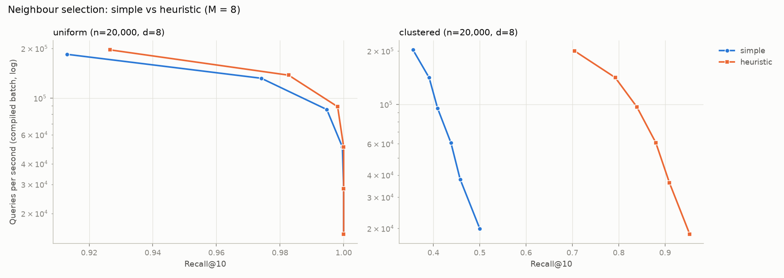
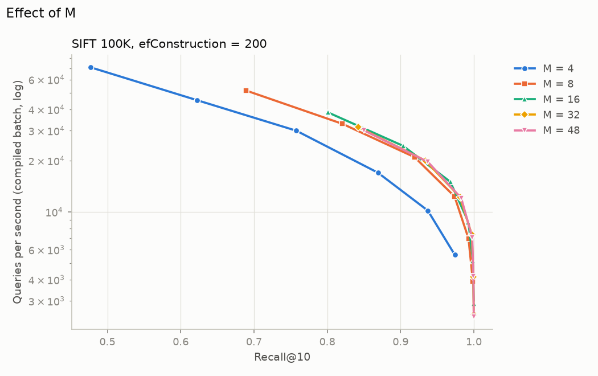
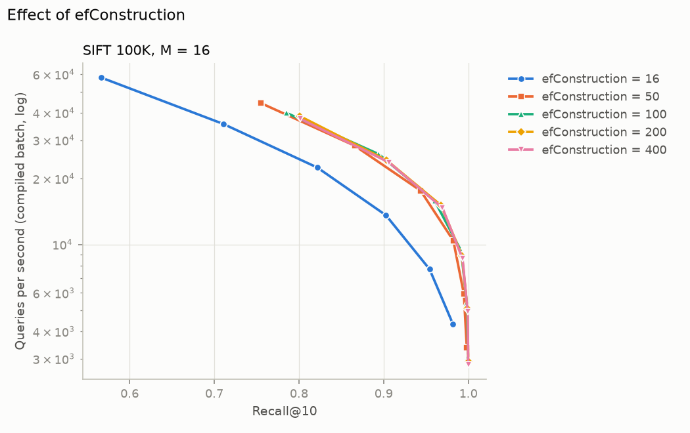
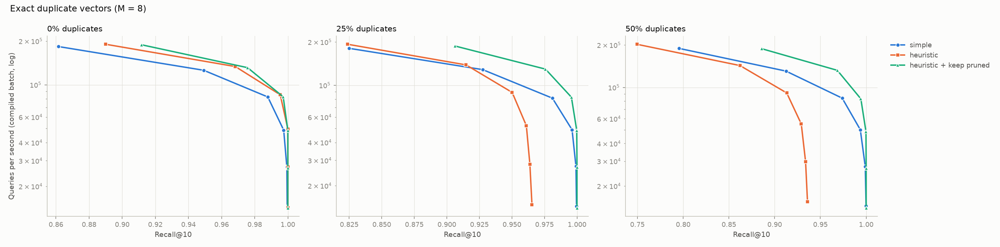
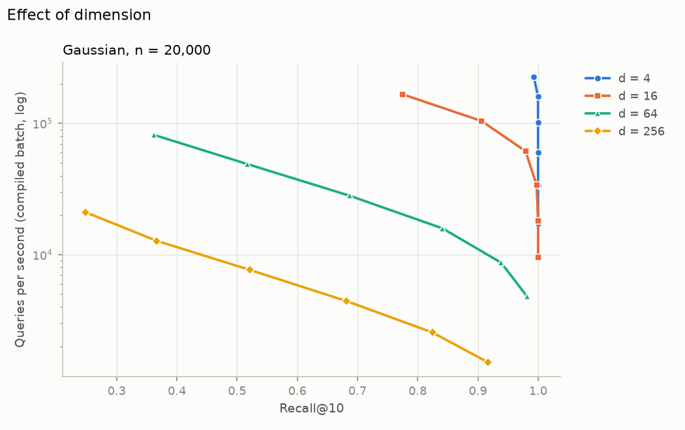
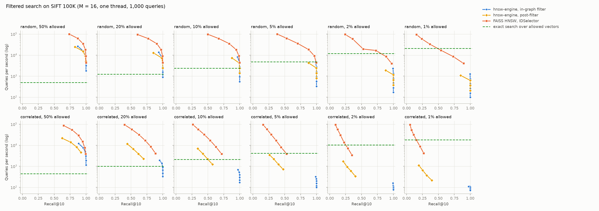

# Studies: what each HNSW design choice does

Milestone A6 (sections 1-6) and Tier 3 (sections 7-8). Short, controlled experiments, each
changing one variable, run on the compiled engine (which builds exactly the graphs of the
reference engine) with `benchmarks/run_studies.py`, `run_filtered.py` and `run_quantization.py`.
Raw results: `results/studies/<study>.json`; figures: `docs/figures/study_*.png`.

**How to read the numbers.** Latency here is the mean per query of one compiled `batch_search`
call over 1,000 queries, without per-query Python overhead, so values are lower than in
`BENCHMARKS.md`; comparisons within a study are like for like. Recall@10 uses the same tie-aware
definition as the benchmarks. "Unreachable nodes" counts layer-0 nodes that no search can ever
return, because no chain of links leads to them from the entry point
(`invariants.reachable_from_entry`).

## Key findings

* **The heuristic is what makes HNSW work on clustered data.** With plain "M closest" links,
  recall stalls at 0.50 on 100 tight clusters; the heuristic reaches 0.95 and strands no node.
* **M = 16 and efConstruction = 200 are near the knee** on SIFT 100K: larger values add memory or
  build time for little recall.
* **Exact duplicates break the paper's strict heuristic** (recall capped at 0.97 with 25%
  duplicates, 0.94 with 50%); `keep_pruned_connections` fixes it.
* **Reachability is necessary, not sufficient**: simple selection on clustered data leaves only
  3.7% of nodes unreachable yet loses half the recall, because greedy search cannot leave the wrong
  cluster. Graphs must be judged by recall, not connectivity alone.
* **Filtered search needs a planner** (Tier 3): the in-graph filter keeps recall@10 at 0.95 or
  more for every predicate but its work grows as the predicate tightens; exact search over the
  allowed vectors wins below about 5% for random predicates and already at 10% for correlated
  ones; post-filtering and FAISS's result-only filter lose recall on selective predicates.
* **int8 codes are free on 8-bit data** (Tier 3): lossless on SIFT and Fashion-MNIST with a
  quarter of the vector memory; on GloVe they cost up to 0.0214 recall, which exact re-ranking of
  the beam recovers.

## 1. Simple versus heuristic neighbour selection

*Question.* Does the paper's heuristic (keep a candidate only if it is closer to the new node than
to any link already kept) beat plain "M closest", and does the answer depend on the data?
*Setup.* 20,000 points in 8 dimensions, uniform in the unit cube or 100 tight Gaussian clusters
(spread 0.02); M = 8, efConstruction = 100; 1,000 queries from the same distribution.



<!-- table:study_selection -->
| Data | Selection | Unreachable by any query | Recall@10 (ef 10) | Recall@10 (ef 40) | Recall@10 (ef 160) | Recall@10 (ef 320) | QPS (ef 40) |
|---|---:|---:|---:|---:|---:|---:|---:|
| uniform | simple | 0 | 0.9130 | 0.9947 | 1.0000 | 1.0000 | 85,320 |
| uniform | heuristic | 0 | 0.9265 | 0.9981 | 1.0000 | 1.0000 | 88,770 |
| clustered | simple | 732 | 0.3560 | 0.4092 | 0.4578 | 0.5004 | 95,028 |
| clustered | heuristic | 0 | 0.7045 | 0.8391 | 0.9095 | 0.9533 | 96,909 |
<!-- /table:study_selection -->

*Finding.* On uniform data the two strategies are equivalent: no unreachable nodes, recall 1.0000
from efSearch 160, the heuristic slightly ahead with small beams (0.9265 vs 0.9130 at efSearch 10).
On clustered data the difference is categorical: "M closest" leaves 732 of 20,000 nodes
unreachable by any query and recall stalls at 0.5004 even with efSearch 320, while the heuristic
leaves none and reaches 0.9533. Stranding explains only part of the loss (3.7% of the nodes): with
plain closest-M links nearly every link stays inside its cluster, so a greedy search that enters
the wrong cluster cannot climb out. The graph is mostly connected but not navigable. The
heuristic keeps links that point out of clusters, which is exactly the paper's argument for it.

## 2. Effect of M

*Question.* How do more links per node trade build time and memory against search quality?
*Setup.* SIFT, first 100,000 vectors; efConstruction = 200; M in {4, 8, 16, 32, 48}.



<!-- table:study_m -->
| M | Build (s) | Index size (MB) | Unreachable by any query | Recall@10 (ef 10) | Recall@10 (ef 40) | Recall@10 (ef 160) | Recall@10 (ef 320) | QPS (ef 40) |
|---|---:|---:|---:|---:|---:|---:|---:|---:|
| 4 | 12.2 | 55.9 | 101 | 0.4774 | 0.7578 | 0.9372 | 0.9741 | 29,996 |
| 8 | 15.6 | 58.9 | 0 | 0.6889 | 0.9191 | 0.9927 | 0.9987 | 20,979 |
| 16 | 20.2 | 65.3 | 0 | 0.8010 | 0.9678 | 0.9988 | 0.9999 | 15,037 |
| 32 | 22.3 | 78.0 | 0 | 0.8425 | 0.9810 | 0.9993 | 0.9999 | 12,257 |
| 48 | 22.8 | 90.8 | 0 | 0.8498 | 0.9828 | 0.9994 | 0.9999 | 12,047 |
<!-- /table:study_m -->

*Finding.* Recall at a fixed beam rises steeply up to M = 16 and then flattens (at efSearch 40:
0.7578, 0.9191, 0.9678, 0.9810, 0.9828 for M = 4, 8, 16, 32, 48), while the index grows from 55.9
to 90.8 MB and throughput at efSearch 40 falls from 29,996 to 12,047 queries/s, because each hop
evaluates more links. M = 4 also leaves 101 nodes unreachable. Build time grows only from 12.2 s to
22.8 s. The common default M = 16 sits where extra links stop paying for themselves on SIFT.

## 3. Effect of efConstruction

*Question.* How much does a wider beam during construction improve the graph?
*Setup.* SIFT, first 100,000 vectors; M = 16; efConstruction in {16, 50, 100, 200, 400}.



<!-- table:study_efc -->
| efConstruction | Build (s) | Unreachable by any query | Recall@10 (ef 10) | Recall@10 (ef 40) | Recall@10 (ef 160) | Recall@10 (ef 320) | QPS (ef 40) |
|---|---:|---:|---:|---:|---:|---:|---:|
| 16 | 2.0 | 16 | 0.5663 | 0.8217 | 0.9542 | 0.9819 | 22,467 |
| 50 | 5.8 | 0 | 0.7554 | 0.9436 | 0.9947 | 0.9982 | 17,616 |
| 100 | 11.1 | 0 | 0.7850 | 0.9603 | 0.9982 | 0.9997 | 15,814 |
| 200 | 20.2 | 0 | 0.8010 | 0.9678 | 0.9988 | 0.9999 | 15,087 |
| 400 | 35.9 | 0 | 0.8015 | 0.9695 | 0.9992 | 0.9999 | 14,688 |
<!-- /table:study_efc -->

*Finding.* A narrow construction beam is cheap but builds a worse graph: efConstruction 16 takes
2.0 s but leaves 16 nodes unreachable and reaches 0.8217 recall at efSearch 40, against 0.9678 for
efConstruction 200 (20.2 s). Beyond 200 the returns vanish: 400 costs 78% more build time (35.9 s)
for +0.0017 recall at efSearch 40. Graphs built with a wider beam are slightly slower to search at
the same efSearch (22,467 to 14,688 queries/s at efSearch 40) but more accurate.

## 4. Reachability after pruning

*Question.* Pruning removes links; can it strand nodes? Does `keep_pruned_connections` help?
*Setup.* The two datasets of study 1; M in {2, 4, 8}, efConstruction = 50; simple selection,
heuristic, and heuristic with `keep_pruned_connections`; three seeds each.

<!-- table:study_reachability -->
| Data | M | Selection | Unreachable by any query (seeds 0 / 1 / 2) | Unreachable on layer 0 from the entry point | Mean layer-0 degree |
|---|---:|---:|---:|---:|---:|
| uniform | 2 | simple | 2,173 / 2,022 / 2,154 | 2,296 / 2,129 / 2,249 | 3.02 |
| uniform | 2 | heuristic | 1,070 / 947 / 996 | 1,143 / 1,039 / 1,077 | 3.03 |
| uniform | 2 | heuristic + keep pruned | 933 / 943 / 934 | 1,009 / 1,041 / 1,018 | 3.07 |
| uniform | 4 | simple | 40 / 49 / 48 | 41 / 50 / 52 | 6.31 |
| uniform | 4 | heuristic | 6 / 6 / 4 | 6 / 6 / 5 | 6.00 |
| uniform | 4 | heuristic + keep pruned | 3 / 4 / 3 | 3 / 4 / 3 | 6.35 |
| uniform | 8 | simple | 1 / 1 / 1 | 1 / 1 / 1 | 12.77 |
| uniform | 8 | heuristic | 0 / 0 / 0 | 0 / 0 / 0 | 10.85 |
| uniform | 8 | heuristic + keep pruned | 0 / 0 / 0 | 0 / 0 / 0 | 12.84 |
| clustered | 2 | simple | 13,348 / 10,427 / 11,445 | 19,551 / 19,187 / 19,805 | 3.00 |
| clustered | 2 | heuristic | 1,667 / 1,323 / 1,726 | 19,567 / 1,607 / 2,266 | 2.91 |
| clustered | 2 | heuristic + keep pruned | 980 / 985 / 1,073 | 1,325 / 1,773 / 1,647 | 3.05 |
| clustered | 4 | simple | 2,487 / 2,135 / 2,529 | 9,576 / 18,891 / 19,427 | 6.17 |
| clustered | 4 | heuristic | 26 / 29 / 26 | 31 / 33 / 30 | 5.48 |
| clustered | 4 | heuristic + keep pruned | 7 / 10 / 5 | 11 / 10 / 6 | 6.30 |
| clustered | 8 | simple | 1,056 / 770 / 435 | 2,389 / 19,282 / 3,692 | 12.44 |
| clustered | 8 | heuristic | 0 / 0 / 0 | 0 / 0 / 0 | 8.62 |
| clustered | 8 | heuristic + keep pruned | 0 / 0 / 1 | 0 / 0 / 1 | 12.69 |
<!-- /table:study_reachability -->

*Finding.* Two views are reported: nodes that no query can reach once the descent through the
upper layers is taken into account (the meaningful one), and the stricter count from the layer-0
entry point alone. They differ most for simple selection on clustered data (13,348 versus 19,551 at
M = 2, seed 0), because upper layers link clusters that layer 0 does not.

1. **Tiny M strands nodes whatever the strategy**: at M = 2 even uniform data leaves 947-1,070
   nodes unreachable with the heuristic and 2,022-2,173 with simple selection.
2. **Clustered data is where selection matters**: simple selection strands 10,427-13,348 nodes at
   M = 2, 2,135-2,529 at M = 4 and 435-1,056 at M = 8, with large variation between seeds; the
   heuristic strands 26-29 at M = 4 and none at M = 8.
3. **keep_pruned_connections helps at small M** (clustered, M = 4: 5-10 versus 26-29 unreachable;
   M = 2: 980-1,073 versus 1,323-1,726) at the cost of a higher degree (6.30 versus 5.48 at M = 4),
   hence slower searches. At M = 8 it brought no benefit (one seed stranded a single node).

## 5. Exact duplicate vectors under the heuristic

*Question.* The paper's heuristic uses a strict inequality, so a candidate that is an exact copy of
a kept neighbour, or of the node itself, is always pruned (`test_duplicate_of_base_starves_the_node`).
What does that do to a dataset with many duplicates?
*Setup.* 20,000 Gaussian points in 8 dimensions where 0%, 25% or 50% of the rows are replaced by
copies of other rows; M = 8, efConstruction = 100; the three selection settings of study 4.



<!-- table:study_duplicates -->
| Duplicates | Selection | Unreachable by any query | Mean layer-0 degree | Recall@10 (ef 10) | Recall@10 (ef 40) | Recall@10 (ef 160) | Recall@10 (ef 320) | QPS (ef 40) |
|---|---:|---:|---:|---:|---:|---:|---:|---:|
| 0% | simple | 17 | 12.61 | 0.8616 | 0.9879 | 0.9994 | 0.9996 | 82,437 |
| 0% | heuristic | 1 | 11.02 | 0.8901 | 0.9954 | 1.0000 | 1.0000 | 85,374 |
| 0% | heuristic + keep pruned | 0 | 12.83 | 0.9117 | 0.9972 | 1.0000 | 1.0000 | 82,657 |
| 25% | simple | 15 | 12.58 | 0.8249 | 0.9811 | 0.9992 | 0.9996 | 81,299 |
| 25% | heuristic | 106 | 8.58 | 0.8239 | 0.9502 | 0.9638 | 0.9654 | 89,124 |
| 25% | heuristic + keep pruned | 0 | 12.57 | 0.9064 | 0.9957 | 1.0000 | 1.0000 | 82,564 |
| 50% | simple | 9 | 12.57 | 0.7955 | 0.9738 | 0.9990 | 0.9999 | 83,936 |
| 50% | heuristic | 271 | 7.31 | 0.7495 | 0.9132 | 0.9338 | 0.9359 | 91,373 |
| 50% | heuristic + keep pruned | 0 | 12.46 | 0.8858 | 0.9942 | 1.0000 | 1.0000 | 82,958 |
<!-- /table:study_duplicates -->

*Finding.* The behaviour pinned by the unit test appears at scale. With 25% exact duplicates the
strict heuristic leaves 106 nodes unreachable, the mean layer-0 degree drops from 11.02 to 8.58 and
recall stalls at 0.9654 even with efSearch 320; with 50% duplicates: 271 unreachable, degree 7.31,
recall 0.9359. Mechanism: when a copy of an existing point is inserted, the original is its
closest candidate (distance 0) and is kept first; every other candidate is then exactly as far
from the kept copy as from the new node, so the strict rule prunes all of them, and the same
happens when the original's links are re-selected. Groups of copies end up linked mostly to one
another. Simple selection is unaffected (recall 0.9996-0.9999), and `keep_pruned_connections`
repairs the heuristic completely (no unreachable nodes, recall 1.0000 from efSearch 160).
hnswlib keeps candidates that tie with a kept neighbour (a non-strict comparison), which avoids
the starvation case of the unit test; this project follows the paper's strict wording
(`DECISIONS.md`, D3). For data with many exact duplicates: deduplicate before indexing, or enable
`keep_pruned_connections`.

## 6. Dimension

*Question.* How does the intrinsic difficulty of nearest-neighbour search grow with dimension?
*Setup.* 20,000 Gaussian points in d in {4, 16, 64, 256}; M = 16, efConstruction = 100.



<!-- table:study_dimension -->
| Dimension | Build (s) | Recall@10 (ef 10) | Recall@10 (ef 40) | Recall@10 (ef 160) | Recall@10 (ef 320) | QPS (ef 40) | Distances/query (ef 40) |
|---|---:|---:|---:|---:|---:|---:|---:|
| 4 | 0.5 | 0.9930 | 1.0000 | 1.0000 | 1.0000 | 101,655 | 247 |
| 16 | 0.8 | 0.7744 | 0.9792 | 1.0000 | 1.0000 | 61,431 | 768 |
| 64 | 2.0 | 0.3616 | 0.6872 | 0.9388 | 0.9819 | 28,080 | 1,113 |
| 256 | 9.6 | 0.2480 | 0.5212 | 0.8242 | 0.9171 | 7,652 | 1,174 |
<!-- /table:study_dimension -->

*Finding.* With the graph parameters fixed, the beam needed for a given recall grows quickly with
dimension: at efSearch 40, recall is 1.0000 in 4 dimensions, 0.9792 in 16, 0.6872 in 64 and 0.5212
in 256, and even efSearch 320 reaches only 0.9171 in 256 dimensions. Distances per query at
efSearch 40 grow from 247 to 1,174 while each distance gets 64 times longer, so throughput falls
from 102,865 to 7,693 queries/s. Gaussian noise has no low-dimensional structure; real data of
high nominal dimension behaves far better (Fashion-MNIST, 784 dimensions: recall 0.9948 at
efSearch 40 in `BENCHMARKS.md`) because its intrinsic dimension is much lower.

## 7. Filtered search (Tier 3)

*Question.* Real queries carry metadata predicates. How do in-graph filtering, post-filtering
and exact search over the allowed vectors compare as the predicate gets more selective, and does
it matter where the allowed vectors are?
*Setup.* `benchmarks/run_filtered.py`: SIFT 100K, M = 16, efConstruction = 200, 1,000 queries,
k = 10, one thread, each setting timed as one batch over all queries (median of three). Ground
truth is the exact top 10 among the allowed vectors. Predicates allow 50% to 1% of the vectors,
either *random* (each vector independently) or *correlated* (the vectors with the largest
projection on one random direction, so the allowed vectors occupy one region of the space).
In-graph filtering is `HNSWIndex.batch_search(..., filter=mask)` (design rule 9, the semantics
of hnswlib's filter); post-filtering searches unfiltered for `m * k / selectivity` results
(m = 1, 2, 4, 8) and keeps the allowed ones; FAISS uses an `IDSelectorBitmap` in its HNSW search
parameters; exact search is a compiled loop over the allowed vectors.



**Random predicates.**

<!-- table:study_filtered_random -->
| Allowed vectors | Exact search QPS | In-graph filter: best QPS at recall >= 0.95 | Post-filter: best QPS at recall >= 0.95 | FAISS filtered: best QPS at recall >= 0.95 | In-graph distances per query (ef 40) |
|---|---:|---:|---:|---:|---:|
| 50,206 (50%) | 502 | 16,029 (ef 20) | 15,259 (fetch 40) | 34,563 (ef 40) | 1,184 |
| 19,891 (20%) | 1,228 | 8,002 (ef 20) | 7,373 (fetch 100) | 18,236 (ef 80) | 2,377 |
| 10,084 (10%) | 2,410 | 8,193 (ef 10) | 4,224 (fetch 200) | 9,141 (ef 160) | 3,886 |
| 5,007 (5%) | 4,823 | 4,696 (ef 10) | 2,441 (fetch 400) | 9,279 (ef 160) | 6,343 |
| 2,020 (2%) | 11,883 | 2,355 (ef 10) | 1,161 (fetch 1,000) | 4,020 (ef 320) | 11,524 |
| 978 (1%) | 20,932 | 1,270 (ef 10) | 631 (fetch 2,000) | not reached (max recall 0.896) | 18,080 |
<!-- /table:study_filtered_random -->

**Correlated predicates.**

<!-- table:study_filtered_correlated -->
| Allowed vectors | Exact search QPS | In-graph filter: best QPS at recall >= 0.95 | Post-filter: best QPS at recall >= 0.95 | FAISS filtered: best QPS at recall >= 0.95 | In-graph distances per query (ef 40) |
|---|---:|---:|---:|---:|---:|
| 50,000 (50%) | 443 | 7,678 (ef 20) | not reached (max recall 0.919) | 7,647 (ef 160) | 2,093 |
| 20,000 (20%) | 1,005 | 1,397 (ef 20) | not reached (max recall 0.696) | not reached (max recall 0.886) | 8,923 |
| 10,000 (10%) | 2,148 | 689 (ef 10) | not reached (max recall 0.572) | not reached (max recall 0.716) | 17,303 |
| 5,000 (5%) | 4,146 | 322 (ef 10) | not reached (max recall 0.474) | not reached (max recall 0.530) | 27,189 |
| 2,000 (2%) | 10,279 | 158 (ef 10) | not reached (max recall 0.403) | not reached (max recall 0.350) | 42,601 |
| 1,000 (1%) | 17,994 | 113 (ef 20) | not reached (max recall 0.395) | not reached (max recall 0.270) | 49,526 |
<!-- /table:study_filtered_correlated -->

*Findings.*

1. **The in-graph filter keeps recall and pays for it in work.** Because it keeps searching until
   it holds `ef` allowed results, recall@10 was at least 0.95 at efSearch 20 or more for every
   predicate, and every query received a full top 10. The work grows as the predicate tightens:
   distances per query at efSearch 40 rise from 1,184 (random, 50% allowed) to 18,080 (random,
   1%), and from 2,093 to 49,526 for correlated predicates. At 1% correlated, a query touches about
   half of the 100,000 vectors.
2. **Below a few percent, exact search over the allowed vectors wins.** For random predicates the
   crossover is near 5% (exact search 4,823 queries/s, in-graph filter 4,696 at recall >= 0.95). At
   1%, exact search serves 20,932 queries/s against 1,270. Correlated predicates move the
   crossover up: exact search already leads at 10% (2,148 against 689), and the graph is still
   ahead at 20% (1,397 against 1,005). This is why production engines switch to brute force over
   the filtered subset when a predicate is selective. A rule that only counts allowed vectors
   would still be fooled by correlated predicates, where the graph becomes slow at selectivities
   such a rule treats as safe.
3. **Post-filtering only works when the predicate is unrelated to position.** For random
   predicates, fetching `2k / selectivity` unfiltered results reached recall 0.95 at every
   selectivity, at lower throughput than the in-graph filter from 20% down (4,224 against 8,193
   queries/s at 10%). Its timings include a Python step that keeps the allowed ids of each result
   list, which slightly favours the compiled in-graph filter where both are fast (at 50% allowed,
   15,259 against 16,029 queries/s). For correlated predicates it never reached 0.95 (best recall
   0.919 at 50% allowed, 0.395 at 1%). The unfiltered neighbourhood of a query far from the allowed
   region contains no allowed vector, however many results are fetched.
4. **FAISS's filter restricts the results, not the traversal.** FAISS computed the same number of
   distances per query under every predicate: 730 at efSearch 40 (729.9 in its unfiltered
   benchmark run) and 3,379 at efSearch 320. Its cost therefore stays flat, and it is
   the fastest option while the predicate is mild (34,563 queries/s at recall >= 0.95 with 50%
   random). But the allowed neighbours must already be in the beam, so recall falls as the
   predicate tightens. With 1% random it peaks at 0.896 (efSearch 320), and at efSearch 40 only
   13.7% of queries received a full top 10. With correlated predicates it reaches 0.95 only at 50%
   allowed. FAISS is compiled C++ and our engine is Numba, so the throughput comparison mixes
   implementation speed with search strategy; the distance counts isolate the strategy.

## 8. int8 scalar quantization (Tier 3)

*Question.* How much recall does one byte per dimension cost, and does re-ranking with exact
distances recover it?
*Setup.* `benchmarks/run_quantization.py`: on SIFT 100K, Fashion-MNIST 60K and GloVe 100K the
float32 graph (M = 16, efConstruction = 200, seed 0) is searched three ways: normally; with
distances to the int8 codes (`QuantizedIndex`, design section 9.2); and with codes followed by
exact re-scoring of the `efSearch` candidates the beam returns. 1,000 queries, one thread, each
setting one compiled batch, median of three. Memory counts the vectors the traversal reads and
the graph's link slots and levels.

<!-- table:study_quantization -->
| Dataset | Codes lossless | Vectors: float32 / int8 (MB) | Graph links (MB) | Recall@10 ef 40: float32 / int8 / int8 + re-rank | Recall@10 ef 160: float32 / int8 / int8 + re-rank | Largest recall drop vs float32: int8 / int8 + re-rank | QPS vs float32: int8 / int8 + re-rank |
|---|---:|---:|---:|---:|---:|---:|---:|
| sift-128-euclidean (100,000 x 128) | yes | 51.2 / 12.8 | 14.1 | 0.9678 / 0.9678 / 0.9678 | 0.9988 / 0.9988 / 0.9988 | +0.0000 / +0.0000 | 1.11-1.15x / 1.03-1.07x |
| fashion-mnist-784-euclidean (60,000 x 784) | yes | 188.2 / 47.0 | 8.4 | 0.9948 / 0.9948 / 0.9948 | 0.9988 / 0.9988 / 0.9988 | +0.0000 / +0.0000 | 0.90-0.96x / 0.83-0.89x |
| glove-100-angular (100,000 x 100) | no (max error 0.0028) | 40.0 / 10.0 | 14.1 | 0.7769 / 0.7683 / 0.7773 | 0.9176 / 0.9002 / 0.9182 | +0.0214 / +0.0011 | 1.09-1.16x / 0.99-1.06x |
<!-- /table:study_quantization -->

*Findings.*

1. **On 8-bit data the codes are lossless and the search is unchanged.** SIFT and Fashion-MNIST
   store whole numbers from 0 to 255, so the quantizer chooses step 1, and the int8 traversal
   returns exactly the float32 results: the same recall and the same distance counts at every
   efSearch, with a quarter of the vector memory (51.2 to 12.8 MB for SIFT 100K, 188.2 to 47.0 MB
   for Fashion-MNIST). The graph's links (14.1 MB for SIFT) are unchanged.
2. **On GloVe the codes cost recall, and re-ranking recovers it.** GloVe's normalised vectors are
   not 8-bit (step 0.0056, largest reconstruction error 0.0028). Traversal over codes lost up to
   0.0214 recall@10 (0.9603 to 0.9389 at efSearch 320). Re-scoring the efSearch candidates with
   exact float32 distances brought it back to within 0.0011 of float32 at every efSearch (0.9182
   against 0.9176 at efSearch 160).
3. **Speed barely moves.** Reading one byte instead of four per dimension made the traversal
   1.09-1.16x as fast on SIFT and GloVe but 0.90-0.96x on Fashion-MNIST (784 dimensions); with
   re-ranking included the range is 0.83-1.07x. The point of int8 here is memory, not speed.
4. **Limit of this implementation.** `QuantizedIndex` keeps the `HNSWIndex` (and so the float32
   vectors) next to the codes, because re-ranking needs them. The memory saving becomes real only
   when the float32 vectors stay on disk, for example memory-mapped with `load_native`
   (`PERFORMANCE.md` section 5), so that only re-ranking touches them; that combination was not
   measured here.

## Reproduction

```bash
make studies        # about 10 minutes
make filtered       # filtered-search study
make quantization   # int8 study
```
